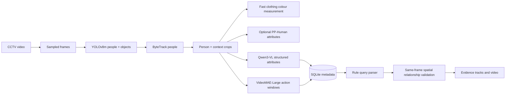

# AI Detective

This is an explainable, metadata-driven CCTV investigation application: sampled frames -> YOLOv8 person/object detection -> ByteTrack person tracking -> person crops -> local clothing-colour measurement + optional PP-Human/Qwen attributes -> VideoMAE actions -> SQLite -> evidence-grounded natural-language retrieval.

It is intentionally not a mock system. Detections and track IDs are produced by Ultralytics YOLOv8 with ByteTrack. Attribute extraction only writes data returned and validated from Qwen3-VL. Action labels are not invented: the action stage stays visibly unavailable until a compatible, local VideoMAE-Large checkpoint is provided.

## Architecture



## Run locally

Requirements: Python 3.11+, Node 20+, FFmpeg-compatible OpenCV backend. A CUDA GPU is strongly recommended for Qwen3-VL.

```powershell
Copy-Item .env.example .env
python -m venv .venv
.\.venv\Scripts\Activate.ps1
pip install -r requirements.txt
Set-Location backend
$env:PYTHONPATH = (Get-Location).Path
uvicorn app.main:app --reload
```

In a second terminal:

```powershell
Set-Location frontend
npm install
npm run dev
```

Open the Vite URL (normally `http://localhost:5173`), create an account, upload footage, then start processing. The job API returns immediately and the page polls real job state.

## Models

- **YOLOv8m** is configured by `YOLO_MODEL`; set `yolov8x.pt` for YOLOv8x. Ultralytics downloads an absent YOLO weight on first execution, so ensure your network/model cache policy permits it.
- **Fast clothing colour measurement** runs once on the clearest crop of each track. It indexes only a dominant visible upper/lower colour and returns `unknown` for very small, dark or mixed crops. It is deliberately fast and deterministic; it is not a claim of fabric colour under all lighting.
- **PP-Human person attributes (optional, open source)** complements Qwen with a local PaddleDetection exported person-attribute model. It detects model-supported presentation attributes such as female presentation, hat/glasses, bag types, sleeve/garment cues and held-object cues. PP-Human does not provide clothing colour, so the local colour stage remains the colour source. Download the official PP-Human exported person-attribute inference model into `storage/models/pphuman-person-attribute` so that folder contains `inference.pdmodel` and `inference.pdiparams`, install the CUDA build of PaddlePaddle compatible with your NVIDIA driver/CUDA, then set `PPHUMAN_ENABLED=true`. Leave it `false` until that model is present: Qwen continues as the fallback and processing does not break.
- **Qwen3-VL-2B-Instruct** is loaded lazily and runs at the person-track level, never during search. It ranks clear person crops, uses `QWEN_MAX_FRAMES_PER_TRACK` representative frames (default `1` for throughput), caches a prior same-video/track result during reprocessing, and logs call timing/cache metrics. Its response is extracted as JSON and validated by Pydantic. Failed/malformed output cannot crash the job; locally measured colour evidence is retained.
- **VideoMAE-Large** needs a compatible action checkpoint with the required label mapping. Set `ACTION_MODEL_PATH`; before doing so the job reports that action recognition is skipped. The adapter avoids claiming an HMDB51 checkpoint exists.
- **GPU acceleration:** set `DEVICE=auto` (recommended) to use CUDA automatically when a CUDA-enabled PyTorch installation and NVIDIA driver are present, or set `DEVICE=cuda` to require it. YOLO, Qwen3-VL, and VideoMAE then use CUDA; YOLO and VideoMAE use FP16 inference. Check `/api/health` or the backend `[GPU]` startup log to confirm the selected GPU.
- **Gemini query interpretation and answer:** set `GEMINI_ENABLED=true` and `GEMINI_API_KEY` in `.env`, then restart the backend. Gemini translates a question to constrained filters and writes one concise answer from the retrieved JSON facts only. SQLite retrieval remains the evidence authority and the interface exposes one supporting evidence item. If Gemini is unavailable, deterministic local parsing/answers remain active. The API lists the models allowed for your key and picks a compatible Flash model if the configured name is no longer available.

Run `python scripts/check_models.py` to inspect readiness without downloading weights.

## Storage and security

Uploads are saved using UUID filenames under `storage/uploads`; database authorization checks enforce video ownership for uploads, job status, video streaming, searches, and evidence files. Passwords use bcrypt; API authentication uses bearer JWTs. Large media/model output is ignored by Git.

## Search behavior

The parser maps common synonyms (for example `man -> male`, `rucksack -> backpack`, `walking -> walk`) and normalizes colors. YOLO non-person observations are stored separately from ByteTrack person IDs. Queries involving an object require an `object_relationships` row that joins the person detection and object observation in the **same frame**, with measured box overlap and normalized distance; the system does not infer a relationship from global video co-occurrence. “Carrying”/“holding” stays labelled as `associated_with` unless a specialised action model verifies it. Every result provides the exact evidence frame, timestamps, bounding boxes, video URL, and bounded playback interval.

Good evidence-grounded questions (the UI offers only prompts which match indexed facts) include:

- `How many people are in the video?`
- `How many women are in the video?` — only after the attribute model produced female evidence.
- `Find people wearing a blue top` or `Find people wearing black lower clothing`.
- `Find a person near a bicycle`, `Find a person with a backpack`, or `Find people walking` — only when the corresponding same-frame relationship/action evidence exists.

Avoid identity, intent, or certainty questions such as “who is this?”, “is this person a criminal?”, or “what exact colour is this in poor lighting?”; the indexed evidence cannot support those claims.

## Printable analysis report

After a video completes processing, open `http://127.0.0.1:8000/api/videos/<video_id>/report/print` in the browser, replacing `<video_id>` with the ID shown by the API/video selector. The report is print-ready and includes video metadata, all detected object classes with their frame-observation totals and average confidence, plus every person track's Qwen attributes, VideoMAE actions, and strongest measured spatial relationships. The report deliberately labels all results as model-derived evidence: confidence is not a guarantee of identity, gender, clothing colour, or unique object count, so investigators must review the source footage/evidence before drawing a conclusion.

## Current scope and limitations

The implemented vertical slice includes registration/login, secure upload, real frame sampling/detection/tracking, context crops, SQLite indexing, deterministic search, a live processing state, original-video access, and evidence-MP4 generation. The React interface presents this flow.

Before a full investigation run, provide model credentials/cache access for Qwen and a checkpoint + preprocessing/label mapping for VideoMAE-Large. The current action adapter purposely does not guess an incompatible checkpoint format. Evaluation metrics require separately supplied ground truth and are therefore not fabricated.

### CPU-oriented Qwen settings

`QWEN_ENABLED=false` skips attribute inference while preserving detection, tracking, suggestions supported by spatial/action evidence, and object searches. On CPU, keep `QWEN_MAX_FRAMES_PER_TRACK=1`, `QWEN_INCLUDE_CONTEXT=false`, and a modest `QWEN_MAX_NEW_TOKENS=128`. Increase representative frames to two or three only when improved robustness is worth the additional inference time.

## Tests

```powershell
Set-Location backend
$env:PYTHONPATH = (Get-Location).Path
pytest
```
